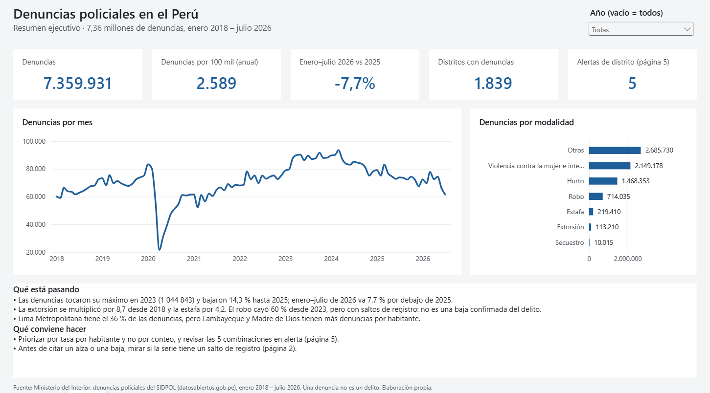
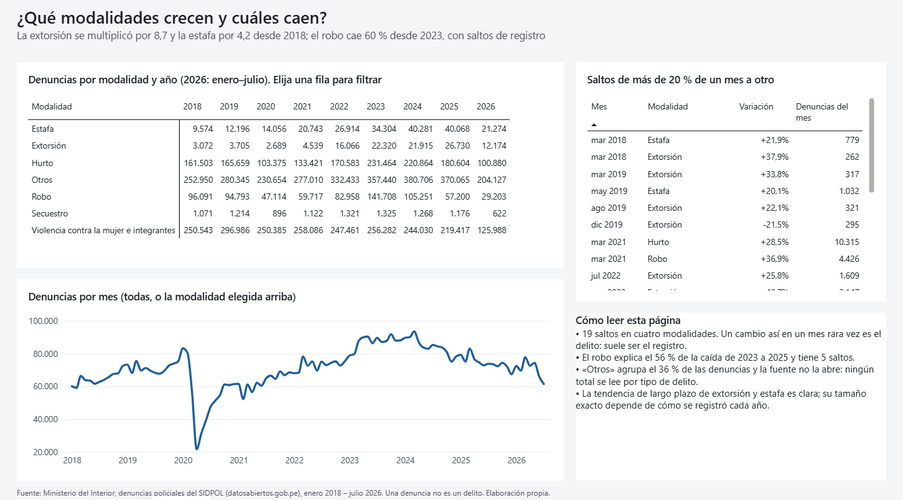
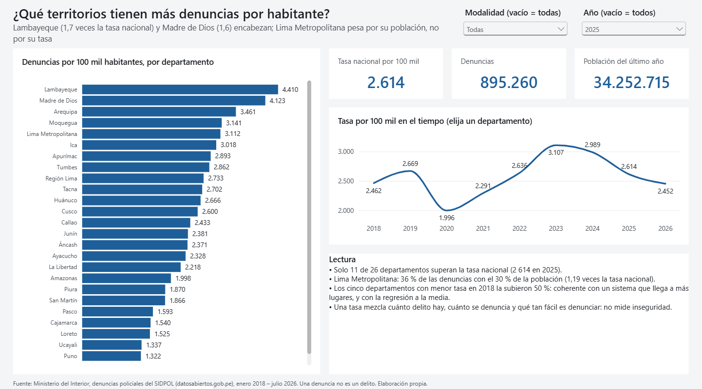
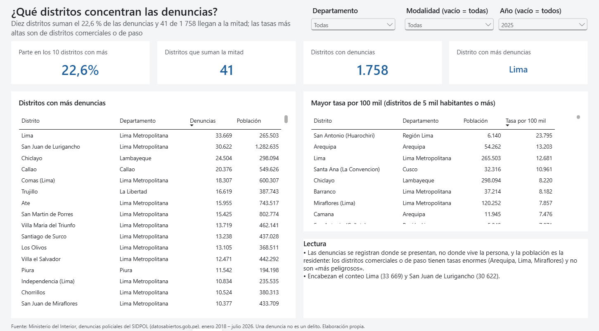
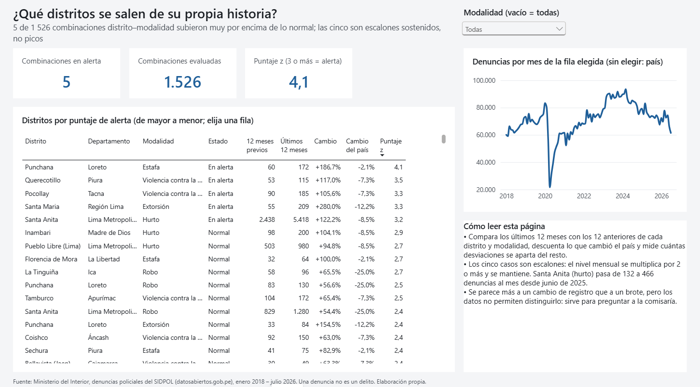
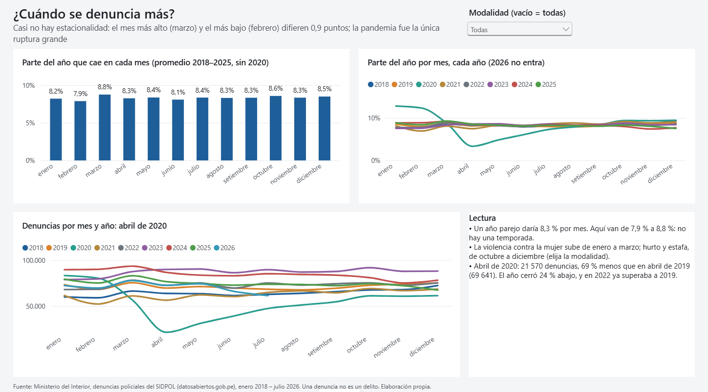
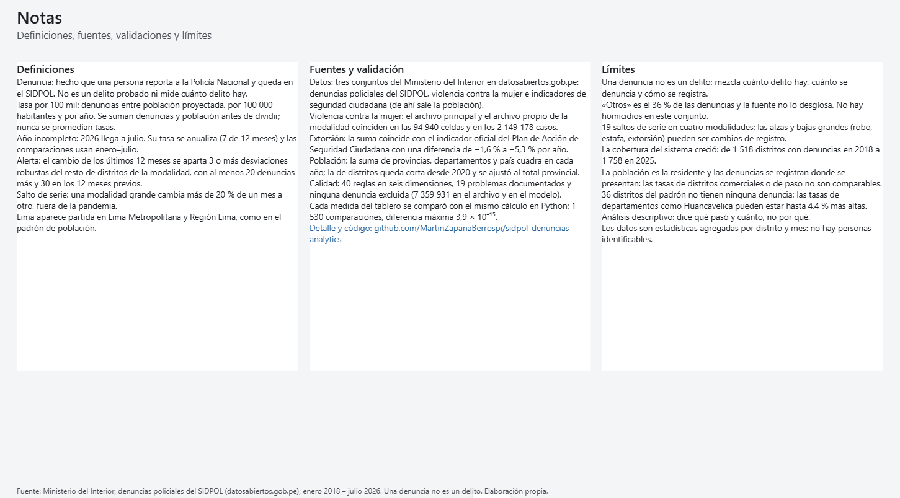

# SIDPOL Denuncias Analytics

[](https://github.com/MartinZapanaBerrospi/sidpol-denuncias-analytics/actions/workflows/ci.yml)
[](https://www.datosabiertos.gob.pe/dataset/denuncias-policiales-registradas-nivel-nacional-mininter)
[](powerbi/)
[](src/)
[](LICENSE)

Análisis de las **denuncias policiales del Perú**: 7,36 millones registradas por la Policía Nacional
entre enero de 2018 y julio de 2026. Se hizo de punta a punta con **datos abiertos reales** del
Ministerio del Interior, desde tres archivos del portal hasta un tablero de Power BI para gerencia.

**[Ver el tablero en Power BI →](https://app.powerbi.com/view?r=eyJrIjoiODYyYzdjYTItOTc2My00Zjg5LTlhYTUtYzM3OGViZjQ0Mzk1IiwidCI6IjFlYmE0NDNmLTIzZTUtNDUzNC05MGQxLTA5NzZhYWJlODZhYyIsImMiOjR9&pageName=p1_resumen)**



## La pregunta

¿Cómo cambiaron las denuncias policiales entre 2018 y 2026, qué modalidades explican el cambio, qué
territorios tienen más denuncias por habitante y qué distritos se están saliendo de su propia
historia?

**Para quién es el tablero.** Para la gerencia de seguridad ciudadana de un gobierno regional o
municipal, o para un analista del Ministerio del Interior, que necesita decidir dónde reforzar
patrullaje, comisarías o campañas.

**Una advertencia antes de leer.** Una denuncia no es un delito: es un hecho que alguien decidió
reportar. Los cambios en la cantidad pueden venir de más delito, de más confianza en la policía, de
más facilidad para denunciar o de cómo se registra. El proyecto es descriptivo y **no estima causas**;
cada hallazgo dice qué mide y qué no.

## Hallazgos

Datos hasta julio de 2026. Las comparaciones con 2026 usan enero–julio de cada año, y su tasa por
habitante se anualiza.

1. **Las denuncias subieron hasta 2023 y bajan desde entonces.** El máximo fue de 1 044 843 en
   2023; en 2025 hubo 895 260 (−14,3 %). Enero–julio de 2026 va 7,7 % por debajo del mismo periodo de
   2025. Por habitante: 2 614 por 100 mil en 2025, frente a 2 462 en 2018.
2. **La extorsión se multiplicó por 8,7 y la estafa por 4,2 desde 2018.** Extorsión pasó de 3 072 a
   26 730 denuncias; estafa, de 9 574 a 40 068. La extorsión baja 24,9 % en enero–julio de 2026.
3. **El robo cayó 60 % de 2023 a 2025, pero no hay que citarlo como una baja del delito.** Explica el
   56 % de la caída total y su serie tiene 5 saltos de nivel (+51,7 % en diciembre de 2022, −26,8 % en
   abril de 2024, −28,1 % en noviembre de 2024). En total hay 19 saltos de más de 20 % de un mes a
   otro, que suelen ser cambios de registro y no del delito.
4. **Lima Metropolitana pesa por su población, no por su tasa.** Concentra el 36 % de las denuncias
   con el 30 % de la población: 3 112 por 100 mil, 1,19 veces la tasa nacional. Las mayores tasas
   de 2025 son las de Lambayeque (4 410) y Madre de Dios (4 123); solo 11 de 26 departamentos superan
   la tasa nacional.
5. **Diez distritos suman el 22,6 % de las denuncias, y 41 de 1 758 llegan a la mitad.** Las tasas
   más altas son de distritos comerciales o de paso (Arequipa, Lima, Miraflores), porque las
   denuncias se registran donde se presentan y la población es la residente.
6. **Cinco combinaciones distrito–modalidad se salen de su propia historia, y las cinco son
   escalones, no picos.** El caso mayor es el hurto en Santa Anita (Lima): de 132 a 466 denuncias al
   mes desde junio de 2025, sostenido por catorce meses. Se parece más a un cambio de registro que a
   un brote, pero los datos no permiten distinguirlo.
7. **No hay estacionalidad: la pandemia fue la única ruptura grande.** Cada mes tiene entre 7,9 % y
   8,8 % de las denuncias del año. En abril de 2020 cayeron 69 % frente a abril de 2019.

## El tablero

Siete páginas, una por pregunta: el título es la pregunta, el subtítulo es la respuesta y debajo hay
la evidencia, una lectura para gerencia y la fuente.

| | |
|---|---|
|  **2. Modalidades.** Matriz modalidad × año, serie mensual y los 19 saltos de serie. |  **3. Territorio.** Tasa por 100 mil de los 26 departamentos, con Lima partida en dos. |
|  **4. Distritos.** Concentración y tasas con la advertencia del lugar de registro. |  **5. Alertas.** Los 1 526 casos por puntaje; al elegir uno se ve su serie. |
|  **6. Calendario.** Parte del año por mes y la pandemia. |  **7. Notas.** Definiciones, fuentes, validaciones y límites. |

El detalle de las páginas, el diseño y cómo abrirlo está en [`powerbi/README.md`](powerbi/README.md).

## Glosario

- **SIDPOL.** Sistema de Denuncias Policiales de la Policía Nacional, donde se registran las denuncias.
- **Tasa por 100 mil habitantes.** Denuncias entre población, por 100 000 habitantes y por año. Se
  suman denuncias y población antes de dividir; nunca se promedian tasas.
- **Anualizada.** Una tasa de 7 meses se lleva a 12 para compararla con un año completo.
- **UBIGEO.** Código de seis dígitos de cada distrito del país.
- **Salto de serie.** Una modalidad grande cambia más de 20 % de un mes a otro, fuera de la pandemia.
- **Alerta.** El cambio de los últimos 12 meses de un distrito se aparta 3 o más desviaciones robustas
  del resto de distritos de su modalidad.

## Cómo se construyó

| Fase | Qué se hizo | Documento |
|---|---|---|
| 0. Definición | Pregunta, usuario, indicadores y reconocimiento de las fuentes probado contra el portal | [00_definicion.md](docs/00_definicion.md) |
| 1. Adquisición | Descarga desde el navegador y manifiesto con hash SHA-256 de cada archivo | [01_adquisicion.md](docs/01_adquisicion.md) |
| 2. Calidad | Perfilado, 40 reglas en seis dimensiones, 19 problemas catalogados y 3 validaciones | [02_calidad.md](docs/02_calidad.md) |
| 3. Transformación | raw → staging → modelo en estrella, con linaje y población ajustada a la oficial | [03_transformacion.md](docs/03_transformacion.md) |
| 4. Modelado | Modelo de Power BI en TMDL con 37 medidas validadas contra Python | [04_modelado.md](docs/04_modelado.md) |
| 5. Análisis | Respuestas a P1–P5 con cifras y advertencias | [05_analisis.md](docs/05_analisis.md) |
| 6. Tablero | Informe de 7 páginas en PBIR, generado por script | [powerbi/README.md](powerbi/README.md) |
| 7–8. Hallazgos y pruebas | Este README y 49 pruebas en GitHub Actions | [`.github/workflows/ci.yml`](.github/workflows/ci.yml) |

**Lo que valida el resultado.**

- **V1.** Las denuncias de violencia contra la mujer del archivo principal coinciden con las del archivo
  propio de esa modalidad en las 94 940 celdas año–mes–distrito y en los 2 149 178 casos: cero diferencias.
- **V2.** La extorsión coincide con el indicador oficial del Plan de Acción de Seguridad Ciudadana con
  una diferencia de −1,6 % a −5,3 % por año, dentro de la tolerancia fijada (6 %). Patrimonio y secuestro
  tienen una definición más amplia en el indicador y se informan, no se usan como prueba.
- **V3.** La población de provincias, departamentos y país cuadra en cada año. La de distritos queda corta
  desde 2020 (hasta −30 % en algunas provincias), así que se reparte el total provincial oficial entre sus
  distritos; el modelo queda dentro de −4,5 % de cada departamento y la brecha son 36 distritos sin
  denuncias.
- **Medidas.** Las 37 medidas DAX se compararon con el mismo cálculo en Python: 1 530 comparaciones,
  diferencia relativa máxima de 3,9 × 10⁻¹⁵ (error de punto flotante).
- **Linaje.** Las 7 359 931 denuncias del archivo original están en el modelo: ninguna se excluyó.

## Cómo reproducirlo

El portal responde 418 a los clientes que no son navegadores y este proyecto **no intenta evadirlo**:
los tres archivos se bajaron una vez desde el navegador (la página de cada conjunto trae su botón de
descarga, enlazada en [`01_adquisicion.md`](docs/01_adquisicion.md)) y se registraron en el manifiesto
[`data/raw/manifest.csv`](data/raw/manifest.csv), con su tamaño y hash.

```bash
pip install -r requirements.txt
# 1. dejar los zip del portal en data/raw/descarga/ y registrarlos
python -m src.extract
# 2. calidad, validaciones, modelo curado y análisis
python -m src.quality
python -m src.validate
python -m src.transform
python -m src.analysis
# 3. pruebas
pytest -q
```

Para **ver solo el tablero** no hace falta ejecutar nada: `data/curated/` viene en el repositorio y
`powerbi/sidpol.pbip` se abre y se actualiza directamente (ver [`powerbi/README.md`](powerbi/README.md)).

## Estructura

```
├── src/          extract · parse · quality · validate · transform · analysis
├── data/
│   ├── raw/        manifest.csv (los archivos originales no se versionan)
│   ├── reference/  tablas hechas a mano: departamentos e inventario del portal
│   └── curated/    modelo en estrella en CSV, lo que lee Power BI
├── powerbi/      sidpol.pbip · modelo (TMDL) · informe (PBIR)
├── tools/        generadores del modelo y del informe, validación de medidas, capturas
├── reports/      validaciones, calidad, linaje y análisis
├── tests/        49 pruebas con recortes de los archivos reales
└── docs/         una página por fase · img/ capturas del tablero
```

## Limitaciones

- **Una denuncia no es un delito.** Mezcla cuánto delito hay, cuánto se denuncia y cómo se registra.
  Las tasas por habitante no miden inseguridad.
- **«Otros» es el 36 % de las denuncias** y la fuente no lo desglosa; tampoco hay homicidios. Ninguna
  cifra total puede leerse por tipo de delito.
- **19 saltos de serie en cuatro modalidades.** Las alzas y bajas grandes (robo, estafa, extorsión) pueden
  mezclar cambios de registro con cambios del delito; los datos no permiten separarlos.
- **La cobertura del sistema creció:** de 1 518 distritos con denuncias en 2018 a 1 758 en 2025. Parte
  del aumento de los departamentos con menor tasa puede ser más lugares registrando.
- **Dónde se denuncia no es dónde se vive.** Las tasas de distritos comerciales o de paso (Arequipa,
  Lima, Miraflores, San Antonio de Huarochirí) están infladas por una población residente pequeña.
- **36 distritos del padrón no tienen ninguna denuncia.** No entran al modelo; las tasas de
  departamentos como Huancavelica pueden estar hasta 4,4 % más altas.
- **El último año está incompleto** (julio de 2026) y los datos son dinámicos: los meses recientes pueden
  subir en publicaciones futuras. El manifiesto con hash permite detectar cambios.
- **Análisis descriptivo.** Dice qué pasó y cuánto, no por qué ni qué efecto tuvo ninguna política.

## Fuentes y licencia

Datos de la [Plataforma Nacional de Datos Abiertos](https://www.datosabiertos.gob.pe), Ministerio del
Interior:

- [Denuncias policiales registradas a nivel nacional](https://www.datosabiertos.gob.pe/dataset/denuncias-policiales-registradas-nivel-nacional-mininter)
- [Violencia contra la mujer y los integrantes del grupo familiar registrada por la PNP](https://www.datosabiertos.gob.pe/dataset/violencia-contra-la-mujer-y-los-integrantes-del-grupo-familiar-registrada-por-la-pnp)
- [Indicadores de seguridad ciudadana y tendencias territoriales](https://www.datosabiertos.gob.pe/dataset/indicadores-de-seguridad-ciudadana-y-tendencias-territoriales-mininter)

Son estadísticas agregadas por distrito y mes: no contienen personas identificables. Código bajo
licencia [MIT](LICENSE).
