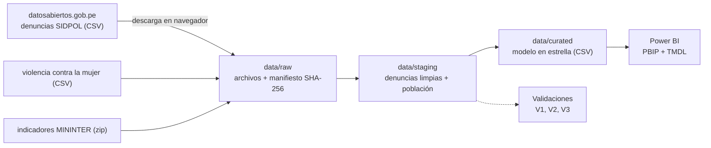

# Fase 0 — Definición del proyecto

> Estado: **cerrada** (2026-10-13). Todo lo que este documento afirma sobre las fuentes se
> comprobó el mismo día contra la Plataforma Nacional de Datos Abiertos, leyendo los archivos
> completos.

## 1. El problema

La inseguridad es la principal preocupación de la ciudadanía, pero casi siempre se discute con
una sola cifra nacional ("las denuncias subieron" o "bajaron"). Esa cifra esconde lo que importa
para decidir dónde y cómo intervenir: **qué modalidades** crecen, **en qué territorios** pesan
más cuando se mide por habitante, y **cuánto de lo que se ve es realmente más delito y cuánto es
más o menos denuncia**.

Este proyecto usa las denuncias que la Policía Nacional registra en su sistema SIDPOL (7,36
millones entre enero de 2018 y julio de 2026) para responder esas preguntas con tasas por 100 mil
habitantes y con la advertencia, en cada hallazgo, de qué mide y qué no mide una denuncia.

**Pregunta central.** ¿Cómo cambiaron las denuncias policiales en el Perú entre 2018 y 2026, qué
modalidades explican el cambio, qué territorios concentran más denuncias por habitante y qué
distritos se están saliendo de su propia historia?

**Usuario del tablero.** La gerencia de seguridad ciudadana de un gobierno regional o municipal,
o un analista del Ministerio del Interior, que prepara el reporte mensual y necesita decidir
dónde reforzar patrullaje, comisarías o campañas.

### Preguntas que el tablero debe responder

| # | Pregunta | Dónde se responde |
|---|---|---|
| P1 | ¿Cómo evolucionaron las denuncias totales y por modalidad desde 2018? | Página *Resumen* y *Modalidades* |
| P2 | ¿Qué modalidades crecen y cuáles caen, y qué tan fiable es esa lectura? | Página *Modalidades* |
| P3 | ¿Qué departamentos, provincias y distritos tienen más denuncias por 100 mil habitantes? | Página *Territorio* |
| P4 | ¿Qué distritos se salen de su propia historia en los últimos 12 meses? | Página *Alertas* |
| P5 | ¿Cuándo se denuncia más a lo largo del año y cómo afectó la pandemia? | Página *Calendario* |

**Lo que el proyecto no afirma.** Una denuncia no es un delito: es un hecho que alguien decidió
reportar. Los cambios en la cantidad pueden venir de cambios en el delito, en la confianza en la
policía, en la facilidad para denunciar o en cómo se registra. Cada hallazgo lo dice. El proyecto
es descriptivo y **no estima causas**.

## 2. Indicadores

| Indicador | Definición | Fuente |
|---|---|---|
| Denuncias | Suma de `cantidad` | Denuncias SIDPOL |
| Tasa por 100 mil habitantes | Denuncias / población proyectada del territorio y año × 100 000 | Denuncias + población |
| Variación interanual | Denuncias del periodo frente al mismo periodo del año anterior | Calculada |
| Participación de la modalidad | Denuncias de la modalidad / denuncias totales | Calculada |
| Concentración territorial | Parte de las denuncias que suman los 10 distritos con más denuncias | Calculada |
| Distritos en alerta | Distritos cuyas denuncias de los últimos 12 meses superan su mediana histórica de ventanas de 12 meses en más de 3 desviaciones robustas | Calculada |
| Índice estacional | Parte de las denuncias del año que cae en cada mes, promedio de años completos | Calculada |
| Cobertura de población | Denuncias en distritos con población conocida / denuncias totales | Calculada |

Las tasas se calculan sumando denuncias y población y dividiendo después: **nunca se promedian
tasas** de distritos de tamaños distintos.

## 3. Alcance

**Incluido**
- Todas las denuncias del conjunto SIDPOL, de **enero de 2018 a julio de 2026** (103 meses).
- Las siete modalidades que publica la fuente, en los 1 839 códigos de distrito (UBIGEO).
- Población proyectada por distrito y año, de los Indicadores de seguridad ciudadana del
  MININTER.

**Fuera de alcance, y por qué**
- *Hora, lugar exacto y perfil de víctima y denunciado.* El archivo es una tabla agregada por
  mes, distrito y modalidad; no trae ese detalle.
- *Delitos específicos dentro de "Otros".* La modalidad "Otros" reúne el 36 % de las denuncias y
  la fuente no la desglosa.
- *Homicidios y otros delitos graves.* No están en este conjunto.
- *Comparar con la victimización de las encuestas.* Está en otros conjuntos, con otra metodología.
- *Efectos de políticas o estados de emergencia.* Sería una pregunta causal; aquí solo se
  describe.

## 4. Reconocimiento de las fuentes

### 4.1 Denuncias policiales registradas a nivel nacional (MININTER)

[Página del conjunto](https://www.datosabiertos.gob.pe/dataset/denuncias-policiales-registradas-nivel-nacional-mininter).
Un solo CSV, que el portal actualiza cada mes.

| Dato | Valor |
|---|---|
| Archivo | `DATASET_Denuncias_Policiales_Ene 2018 a Julio 2026.csv`, 27 442 099 bytes, modificado el 2026-08-13 |
| Filas | 369 100: una por año × mes × distrito × modalidad |
| Periodo | 2018-01 a 2026-07, sin meses faltantes |
| Denuncias | 7 359 931 |
| Codificación | UTF-8, sin BOM, con comillas en el texto y sin ellas en los números |
| Columnas | `ANIO`, `MES`, `DPTO_HECHO_NEW`, `PROV_HECHO`, `DIST_HECHO`, `UBIGEO_HECHO`, `P_MODALIDADES`, `cantidad` |
| Territorio | 26 departamentos, 196 provincias, 1 688 nombres de distrito y 1 839 UBIGEO |
| Modalidades | Otros (36 %), Violencia contra la mujer e integrantes (29 %), Hurto (20 %), Robo (10 %), Estafa (3 %), Extorsión (1,5 %), Secuestro (0,1 %) |
| Calidad básica | Cero filas de longitud irregular, cero vacíos, cero claves repetidas, cantidades enteras de 1 a 1 303 |

**Acceso.** Como el resto del portal, bloquea las descargas por script (418) y no se evade. El
archivo se baja una vez desde el navegador y se registra en un manifiesto (Fase 1).

### 4.2 Violencia contra la mujer y los integrantes del grupo familiar (MININTER)

[Página del conjunto](https://www.datosabiertos.gob.pe/dataset/violencia-contra-la-mujer-y-los-integrantes-del-grupo-familiar-registrada-por-la-pnp).
Es un archivo **independiente**, publicado por la misma institución a partir del mismo sistema,
con las denuncias de esa modalidad por año, mes y distrito (4,3 MB, 94 941 filas).

**Sirve para validar.** Comparado con la modalidad equivalente del archivo principal, coincide
**en las 94 940 celdas año × mes × distrito y en los 2 149 178 casos**, sin una sola diferencia.
Ver la [sección 4.4](#44-validación-prevista).

### 4.3 Indicadores de seguridad ciudadana y tendencias territoriales (MININTER)

[Página del conjunto](https://www.datosabiertos.gob.pe/dataset/indicadores-de-seguridad-ciudadana-y-tendencias-territoriales-mininter).
Un zip con un CSV mensual acumulativo (6 versiones, de enero a julio de 2026; la más reciente
pesa 5,8 MB descomprimida y tiene 116 599 filas) y su diccionario en Excel.

- **Población proyectada** (`POBLACION_PROYECTADA`) por UBIGEO y año, 2018–2026. Permite calcular
  tasas por 100 mil habitantes. La población nacional que informa es de 31,6 millones (2018) a
  34,7 millones (2026).
- **Indicadores SIDPOL** por ámbito (nacional, departamento, provincia, distrito). Son los
  indicadores oficiales del Plan de Acción de Seguridad Ciudadana. El indicador 7 (extorsión,
  según su serie) da 3 223 (2018) a 27 286 (2025) denuncias: **cercano pero no idéntico** a lo
  que suma el archivo principal (3 072 y 26 730). La diferencia se investiga en la Fase 2.

### 4.4 Validación prevista

| # | Comparación | Resultado de la prueba de la Fase 0 |
|---|---|---|
| V1 | Violencia contra la mujer del archivo principal frente al archivo de violencia, celda por celda | Idéntico: 94 940 de 94 940 celdas |
| V2 | Extorsión del archivo principal frente al indicador oficial de extorsión, por año | Siempre menor en el archivo principal: de −1,6 % a −5,3 % según el año; por explicar |
| V3 | Suma de la población de los distritos frente a la población nacional oficial, por año | Pendiente de la Fase 2 |

### 4.5 Problemas de calidad detectados al leer los archivos

Todo lo siguiente se resolverá en las Fases 2 y 3:

1. **UBIGEO sin el cero inicial.** 142 979 filas (39 %) traen el código de 5 dígitos
   (`10202` en lugar de `010202`), porque el archivo lo trató como número. Para unir con la
   población hay que rellenar a 6 dígitos.
2. **Un código con dos nombres.** `160801` aparece como Loreto / Maynas / Putumayo y como Loreto /
   Putumayo / Putumayo (la provincia se creó después). Hay que elegir un nombre vigente.
3. **Lima está partida en dos "departamentos".** `LIMA METROPOLITANA` y `REGION LIMA` comparten
   el código de departamento 15. Es útil para analizar, pero hay que distinguirlo del
   departamento oficial para unir con la población.
4. **Siete distritos nuevos sin población.** Como Alto Tapiche (Loreto) o Yurúa (Ucayali): 459
   denuncias en total, 0,006 %.
5. **La población del archivo de indicadores se repite por indicador.** Cada UBIGEO y año trae
   una fila por indicador con la misma población: sumarla directamente la inflaría nueve veces
   (205 millones en 2018 en vez de 31,6).
6. **Dos archivos con columnas distintas.** El de violencia usa `AÑO`, `CANTIDAD` y otro orden
   de columnas que el principal.
7. **La modalidad "Otros" pesa un tercio.** No se puede abrir; limita cualquier conclusión sobre
   "todas las denuncias".
8. **Cambios fuertes entre años que no son necesariamente cambios del delito.** La extorsión se
   multiplica por 9 (3 072 en 2018, 26 730 en 2025) y el robo cae 60 % de 2023 a 2025 (141 708 a
   57 200). Ambos se tratan como alertas de lectura, no como hechos sobre el delito.
9. **El último año está incompleto.** 2026 llega a julio: las comparaciones usan enero–julio de
   cada año.

## 5. Arquitectura prevista

| Capa | Contenido | ¿Se versiona? |
|---|---|---|
| `data/raw` | Archivos tal como se descargan + manifiesto (URL, fecha, bytes, SHA-256) | No, solo el manifiesto |
| `data/staging` | Denuncias con UBIGEO de 6 dígitos y población unida | No |
| `data/curated` | Hechos y dimensiones que lee Power BI | **Sí** |

**Modelo en estrella previsto**
- Hechos: `fact_denuncia` (año × mes × distrito × modalidad), `fact_poblacion` (distrito × año).
- Dimensiones: `dim_fecha` (mes), `dim_distrito` (UBIGEO, distrito, provincia, departamento,
  zona de Lima), `dim_modalidad`.

## 6. Cómo se mostrará el tablero

- **Publicado en la web de Power BI**, con el enlace en el README, en el *Website* del
  repositorio y en la tarjeta del portafolio.
- Proyecto **PBIP** con TMDL, generado por script, y capturas de cada página en `docs/img/`.
- Los datos son estadísticas agregadas por distrito y mes: no hay personas identificables.

## 7. Criterios de éxito

- [ ] `src/extract.py` verifica los archivos contra el manifiesto.
- [ ] El 100 % de las filas se une a un UBIGEO de 6 dígitos; la población cubre más del 99,9 %
      de las denuncias.
- [ ] V1: la violencia contra la mujer coincide en el 100 % de las celdas.
- [ ] V2: la diferencia con el indicador oficial de extorsión está medida y explicada.
- [ ] V3: la población de los distritos suma la nacional oficial.
- [ ] Las medidas DAX clave coinciden con el mismo cálculo en Python.
- [ ] Cada pregunta P1–P5 tiene una página del tablero y una conclusión con su advertencia.
- [ ] Pruebas automáticas en GitHub Actions, con recortes de los archivos reales.

## 8. Plan de fases

| Fase | Entregable | Documento |
|---|---|---|
| 0. Definición | Problema, KPIs, alcance y reconocimiento de las fuentes | este archivo |
| 1. Adquisición | Descarga en navegador + `src/extract.py` que verifica el manifiesto | `docs/01_adquisicion.md` |
| 2. Calidad | Perfilado, reglas en seis dimensiones y validaciones V1–V3 | `docs/02_calidad.md` |
| 3. Transformación | raw → staging → curated, con linaje | `docs/03_transformacion.md` |
| 4. Modelado | Modelo en estrella + medidas DAX validadas contra Python | `docs/04_modelado.md` |
| 5. Análisis | Respuestas a P1–P5 con cifras | `docs/05_analisis.md` |
| 6. Tablero | PBIP + capturas | `powerbi/`, `docs/img/` |
| 7. Hallazgos | Conclusiones y limitaciones | README |
| 8. Automatización | Pruebas + GitHub Actions | `.github/workflows/` |
| 9. Publicación | Enlace público en el README, el repositorio y el portafolio | README |
