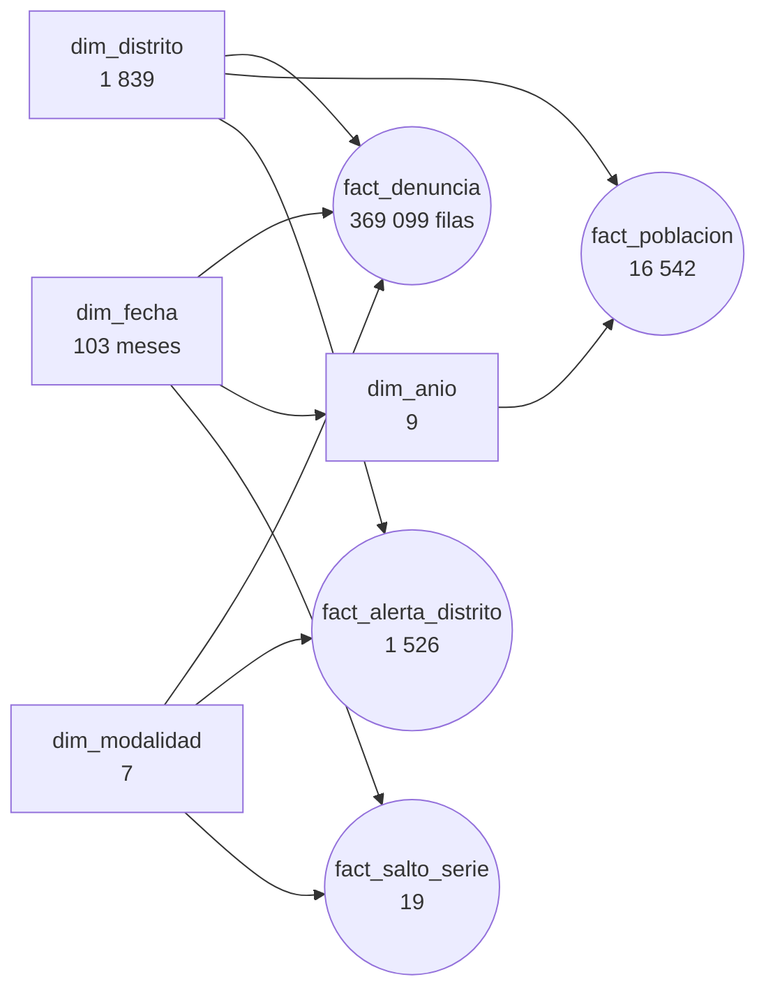

# Fase 4 — Modelado en Power BI

> Estado: **cerrada** (2026-10-13)

## 1. Resumen

El modelo de Power BI se guarda como **proyecto PBIP con TMDL**: tablas, consultas de Power Query,
relaciones y las 37 medidas DAX están en archivos de texto que se leen en GitHub. No se
armó a mano: lo genera [`tools/build_model.py`](../tools/build_model.py), así que es reproducible y
cada cambio queda en el historial.

**Las medidas se validaron contra Python.** En **1 530 comparaciones** (total, cada año, cada
modalidad, cada departamento, cada año × departamento y cada mes) la diferencia relativa máxima es
de 3,9 × 10⁻¹⁵, que es error de punto flotante. Los textos (distrito líder, fecha de corte)
también coinciden. El resultado completo está en
[`reports/validacion_medidas.csv`](../reports/validacion_medidas.csv).

```bash
python tools/build_model.py                 # genera powerbi/sidpol.SemanticModel
python tools/validate_measures.py consulta  # escribe tools/validacion_medidas.dax
powershell -File tools/ejecutar_dax.ps1 -Puerto <puerto de Desktop> -Consulta tools/validacion_medidas.dax -Salida reports/medidas_dax.csv
python tools/validate_measures.py comparar reports/medidas_dax.csv
```

## 2. Modelo



- **Diez relaciones** de muchos a uno, con filtro en un solo sentido: de la dimensión al hecho.
- **`dim_fecha` es mensual** (clave: primer día del mes) y está marcada como tabla de fechas.
  Con eso funciona `DATEADD` para la comparación con el mismo periodo del año anterior.
- **Columnas técnicas ocultas:** claves, cantidades crudas y marcas de 0/1. Quien arma un visual
  ve medidas y atributos, no columnas que sumadas a mano darían resultados engañosos.
- **Sin medidas implícitas** (`discourageImplicitMeasures`): todo número sale de una medida.
- **El parámetro `RutaDatos`** apunta a `data/curated`. Al clonar el proyecto en otra ruta se
  cambia ahí y se actualiza.
- **Cultura `es-PE`** en el modelo y `en-US` al leer los CSV, porque pandas escribe el punto como
  separador decimal.

## 3. Las medidas

| Carpeta | Medida | Qué mide |
|---|---|---|
| Denuncias | `Denuncias` | Denuncias registradas por la Policía Nacional en el SIDPOL. |
| Denuncias | `Denuncias (miles)` | Denuncias en miles. |
| Denuncias | `Distritos con denuncias` | Distritos con al menos una denuncia en el contexto. |
| Denuncias | `Denuncias mismo periodo año anterior` | Denuncias de los mismos meses un año antes. En 2026 compara enero–julio con enero–julio de 2025. |
| Denuncias | `Var. interanual` | Variación frente a los mismos meses del año anterior. Solo con un año elegido: sobre varios años no tiene sentido. |
| Denuncias | `Denuncias ene–jul` | Denuncias de enero a julio de cada año: compara los años completos con el último, que llega hasta el corte. |
| Denuncias | `Var. último periodo vs año anterior` | Variación del último periodo (enero–julio de 2026) frente al mismo periodo del año anterior. No depende del año que se elija en el segmentador; sí respeta modalidad y territorio. |
| Denuncias | `Participación de la modalidad` | Parte de las denuncias que corresponde a la modalidad dentro del contexto (año, territorio). |
| Tasas | `Población del año` | Población proyectada del territorio en el año del contexto. Con varios años los suma: úsela dentro de Habitantes-año. |
| Tasas | `Población (último año)` | Población proyectada del último año elegido (2026 si no se elige ninguno). |
| Tasas | `Meses cubiertos` | Meses del calendario dentro del contexto. Dentro de una iteración por año se evalúa año por año. |
| Tasas | `Habitantes-año` | Población expuesta: cada año suma su población por la fracción del año que cubre el periodo (2026 cubre 7 de 12 meses). |
| Tasas | `Tasa por 100 mil (anual)` | Denuncias por 100 mil habitantes en un año. Si el periodo no es un año completo (2026 llega a julio) queda anualizada, así que es comparable con los demás años. Se calcula como suma entre suma, nunca promediando tasas. |
| Tasas | `Tasa nacional` | La misma tasa para todo el país, con el mismo periodo y modalidad. |
| Tasas | `Veces la tasa nacional` | Tasa del territorio dividida por la nacional: 2 significa el doble. |
| Tasas | `Tasa (distritos de 5 mil hab. o más)` | Tasa en blanco para distritos de menos de 5 mil habitantes, donde pocas denuncias mueven mucho la tasa. |
| Concentración | `Participación top 10 distritos` | Parte de las denuncias que suman los 10 distritos con más denuncias del contexto. |
| Concentración | `Distritos para el 50 %` | Menor número de distritos que, ordenados de mayor a menor, acumulan la mitad de las denuncias. |
| Concentración | `Distrito líder` | Distrito con más denuncias en el contexto. |
| Concentración | `Participación del distrito líder` | Parte de las denuncias que tiene el distrito con más denuncias del contexto. |
| Alertas | `Distritos en alerta` | Combinaciones distrito–modalidad cuyo cambio de los últimos 12 meses se sale 3 o más desviaciones robustas del resto. |
| Alertas | `Combinaciones evaluadas` | Combinaciones distrito–modalidad con al menos 30 denuncias en los 12 meses previos. |
| Alertas | `Denuncias últimos 12 m` | Denuncias de agosto de 2025 a julio de 2026. |
| Alertas | `Denuncias 12 m previos` | Denuncias de agosto de 2024 a julio de 2025. |
| Alertas | `Cambio 12 meses` | Variación de los últimos 12 meses frente a los 12 anteriores. |
| Alertas | `Cambio nacional de la modalidad` | Variación nacional de la modalidad en la misma ventana: lo que cambió el sistema entero. |
| Alertas | `Estado de alerta` | Marca la fila como En alerta cuando el puntaje z es 3 o más. |
| Alertas | `Puntaje z` | Cuántas desviaciones robustas se aparta el distrito del cambio típico de su modalidad (3 o más = alerta). |
| Calendario | `Participación del mes en el año` | Parte de las denuncias del año que cae en el mes. Solo tiene sentido en años completos. |
| Calendario | `Índice estacional` | Promedio de la parte del año que cae en el mes, de 2018 a 2025 sin 2020 (la pandemia deforma sus meses). Un mes parejo tendría 8,3 %. |
| Calendario | `Participación del mes (años completos)` | Igual que Participación del mes en el año, pero en blanco para 2026, que aún no termina. |
| Calidad de datos | `Saltos de serie` | Meses en que una modalidad grande cambió más de 20 % frente al mes anterior, sin contar la pandemia. |
| Calidad de datos | `Denuncias en el mes del salto` | Denuncias de la modalidad en el mes del salto. |
| Calidad de datos | `Variación del salto` | Cambio de la modalidad frente al mes anterior. |
| Calidad de datos | `Denuncias en celdas atípicas` | Denuncias en celdas mes–distrito–modalidad marcadas como atípicas en la Fase 2 (no se excluyen). |
| Textos | `Corte de datos` | Último mes con datos. |
| Textos | `Fuente` | Pie de fuente para cada página. |

## 4. Cómo se calcula la tasa por 100 mil

La población es anual y las denuncias son mensuales, y 2026 solo llega a julio. Dividir sin más
compararía un año de 12 meses con uno de 7. La medida usa **habitantes-año**: cada año aporta su
población multiplicada por la fracción del año que cubre el periodo.

```
Tasa por 100 mil (anual) = Denuncias / Σ_años ( Población del año × Meses cubiertos / 12 ) × 100 000
```

- Para un año completo es la tasa de siempre. Para 2026 queda **anualizada**, y es comparable con
  los demás años.
- Para varios años es el promedio anual ponderado por población, no un promedio de tasas.
- La población de un territorio es la suma de la de sus distritos (`TREATAS` lleva los años de
  `dim_fecha` a `dim_anio`, porque no hay una relación directa entre el calendario mensual y la
  población anual).
- Los distritos de menos de 5 mil habitantes tienen su propia medida, que devuelve vacío: con
  pocas denuncias y poca gente, la tasa salta de un año a otro.

## 5. Lo que salió mal y se corrigió

La validación contra Python encontró un error que el total no mostraba:

- **`Habitantes-año` multiplicaba por todos los meses del calendario.** La primera versión
  escribía `[Población del año] * DISTINCTCOUNT ( dim_fecha[mes_inicio] ) / 12` dentro de un
  `SUMX` sobre los años. Una función de agregación suelta no hace transición de contexto: contaba
  los 103 meses en cada vuelta. Por año daba bien, y en el total la tasa salía en 287 en lugar
  de 2 589. Se corrigió con la medida `Meses cubiertos`, que sí pasa por la transición.
- La misma trampa afecta a `TREATAS ( VALUES ( ... ) )` escrito directamente dentro de un
  `CALCULATE` en una iteración: el argumento se evalúa antes de la transición. Dentro de una
  medida funciona; escrito en línea, no.

Las pruebas de `tests/test_powerbi.py` fijan tres cosas: ninguna variable DAX usa una palabra
reservada (`top` deja la medida en error), el TMDL versionado es exactamente el que genera el
script, y las 1 530 comparaciones cumplen.

## 6. Lo que pasa a la Fase 5

El análisis de P1–P5 usa las mismas definiciones. Las cifras que aparecen en el tablero salen de
`reports/analisis/cifras_clave.csv`, calculado en Python con las reglas de este documento.
